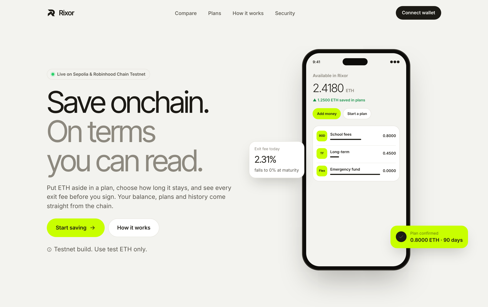
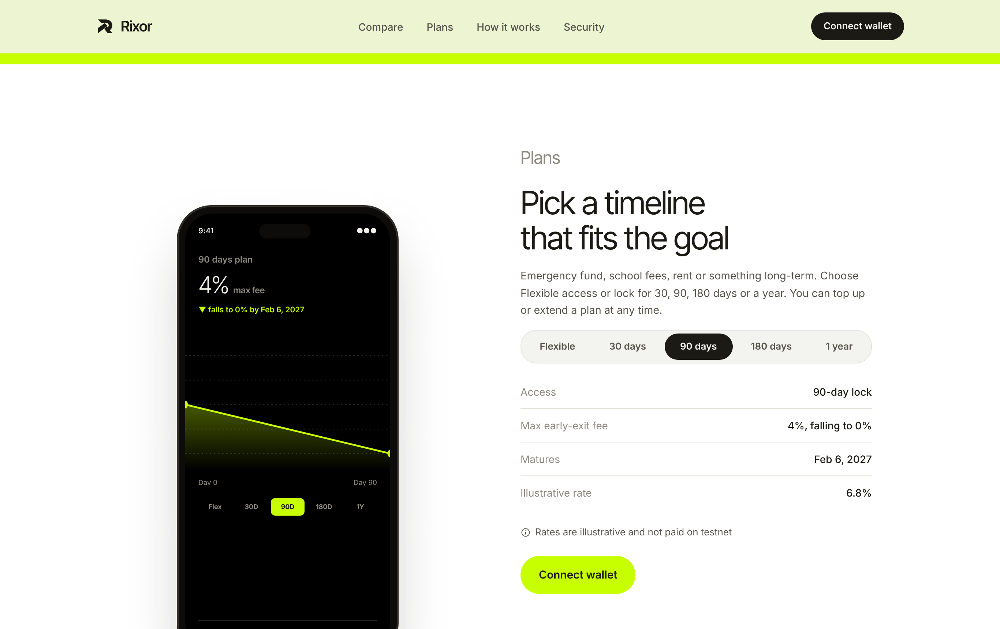
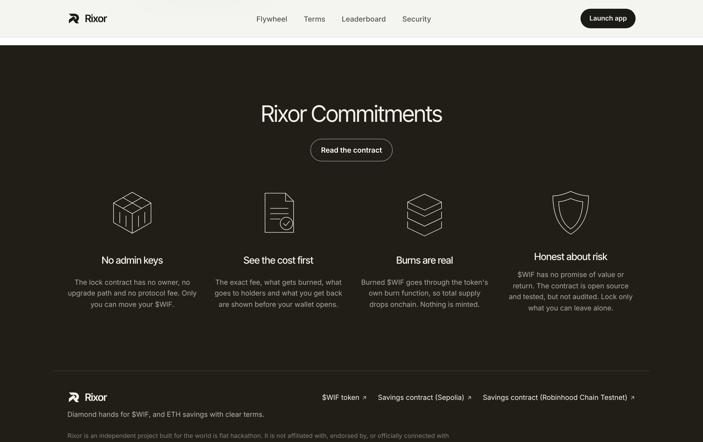
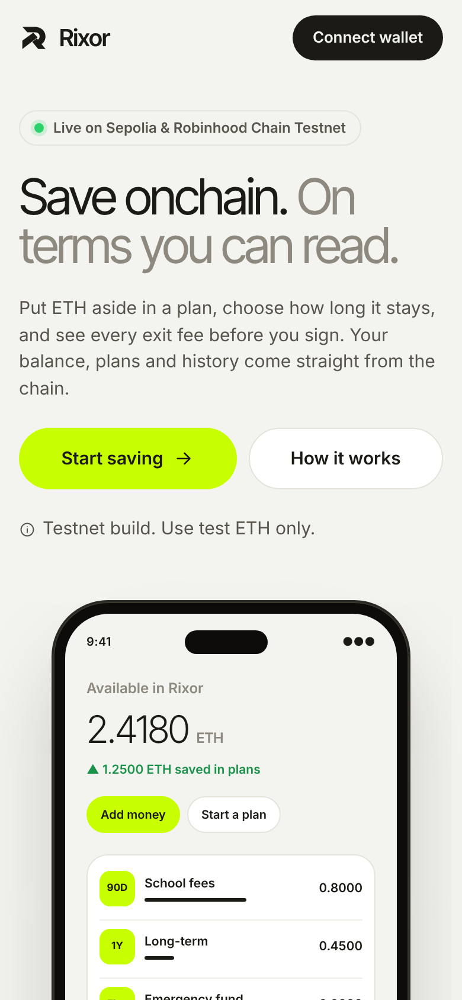

<p align="center">
  
</p>

# Rixor

**Tiered conviction locks, ROI targets, commitment rewards and community challenges, built for $WIF on Robinhood Chain. Testnet first.**

## Conviction vault

Contract: `contracts/RixorConvictionVault.sol`. It works with any burnable ERC-20 and has no owner or admin functions.

| Tier | Reward weight | Leaving early | Free withdrawal |
| --- | ---: | --- | --- |
| Flexible | 1x | Up to 1% fee in the first 7 days | After 7 days |
| Committed | 1.5x | Up to 10%, falling to 0% over the 30-365 day term | ROI target reached, optional max loss hit, or term ended |
| Diamond Hands | 3x | Not allowed | ROI target reached, max loss hit, term ended, or price oracle stale for 7 days |

- **ROI tracking:** the entry price is recorded from the oracle at lock time. `exitStatus(lockId)` returns live ROI, the reason a lock can or cannot exit, and the current fee. Exits take a `maxFeeBps` guard so a fee can never be higher than the one you reviewed.
- **No trapping:** every Committed and Diamond lock has a hard term of at most 365 days. Diamond locks also open if the oracle has been stale for 7 days.
- **Rewards:** early-exit fees split 50/50, half burned and half into the commitment reward pool. Anyone can add to the pool with `fundRewards`. The pool accrues to open locks by weight and is paid only when a commitment completes; early and stop-loss exits forfeit their share to remaining holders.
- **Challenges:** sponsors escrow a reward pool with `createChallenge`. There are holding challenges (keep a qualifying lock open to the end) and performance challenges (also finish at or above an ROI target at the final price), with optional community targets. Holders `joinChallenge` with a lock. After the end anyone can `finalizeChallenge`; participants then `qualify` during a 3-day window and split the pool with `claimChallengeReward`. Failed or stuck challenges are refunded to the sponsor with `refundChallenge`.

Tests: `npm run contract:test` covers every tier, every exit reason, the fee guard, the anti-trap backstops, weighted rewards, forfeits and full challenge lifecycles, with a solvency check after each step.

### Price oracle

The vault reads `IRixorPriceOracle.latestPrice()`. **No verified $WIF price feed exists on Robinhood Chain.** Robinhood's oracle docs list Chainlink feeds for a selected subset of assets and none for WIF, and the one Uniswap V3 WIF/WETH pool has zero liquidity, so it can't provide a time-averaged price. For testnet there is `contracts/testnet/RixorMockPriceOracle.sol`, a hand-set price that is clearly marked as mock in the app. A mainnet launch needs a real oracle adapter first.

### $WIF

The official token is `0x5173b8eA6923c2d40267890D45C46a3480954773` on Robinhood Chain mainnet (chain 4663). I verified it onchain: "World is Flat", WIF, 18 decimals, burnable, no owner. It is **not deployed on Robinhood Chain Testnet**. The app shows your real $WIF balance live and read-only; locking real $WIF needs a mainnet vault and a real oracle, which are deliberately not part of this build.

### App modes

- **Testnet:** real transactions against a deployed vault on Robinhood Chain Testnet. This mode is on only when `VITE_RIXOR_VAULT_ADDRESS` is set.
- **Simulation:** runs entirely in the browser with made-up balances, prices, holders and challenges, using the same rules. Every simulated screen and receipt is labelled, and nothing is sent to a chain.

### Deploying to testnet

```bash
npm run contract:compile
RIXOR_VAULT_TOKEN=<existing burnable ERC-20 on testnet> \
RIXOR_VAULT_MOCK_ORACLE_PRICE=1.0 \
npm run contract:deploy:vault -- robinhood-testnet
```

The script refuses mainnet and the mainnet $WIF address, checks that the token exists and has `burn(uint256)`, and prints the `VITE_RIXOR_VAULT_*` values to add to Vercel.

Rixor is an independent project and is not affiliated with, endorsed by, or officially connected with Robinhood Markets, Inc. $WIF comes with no promise of value or return.

## ETH savings (testnet)

The original Rixor flow: move testnet ETH into an onchain balance, place part of it into a savings plan, understand the lock and early-exit rules before signing, and see activity reconstructed from contract events. Runs on **Sepolia** and **Robinhood Chain Testnet** only.

Rixor is an independent project and is not affiliated with, endorsed by, or officially connected with Robinhood Markets, Inc. $WIF comes with no promise of value or return.

### What is working

- Connect an injected EVM wallet.
- Switch between Sepolia and Robinhood Chain Testnet.
- Read the wallet's native testnet ETH balance.
- Deposit testnet ETH into the Rixor contract.
- Create Flexible, 30-day, 90-day, 180-day, and 1-year savings plans.
- View active plans from onchain state.
- Top up an active plan from the user's Rixor available balance.
- Extend an active plan to a longer lock period.
- Withdraw the available Rixor balance back to the connected wallet.
- Exit an active plan, including a declining early-withdrawal fee for locked plans.
- Preview the early-exit fee, net ETH returned, and an approximate USD loss before signing.
- Read plan history and recent movement from contract events.
- Show wallet approval, pending, and transaction-confirmed UI states.
- Use chain-specific visual identity: Ethereum for Sepolia and the Robinhood feather for Robinhood Chain Testnet.
- Use the canonical Rixor contract deployment for the selected supported testnet.

## Screenshots

### Landing experience



### Plans



### Security



### Mobile



## Smart-contract behavior

The current Solidity contract is `contracts/RixorSavings.sol`.

Core actions:

| Action | Contract behavior |
| --- | --- |
| Deposit | Adds native ETH to the user's `availableBalance` |
| Withdraw available | Sends ETH from `availableBalance` back to the plan owner |
| Create plan | Moves ETH from `availableBalance` into a new savings plan |
| Top up plan | Moves additional ETH from `availableBalance` into an active plan |
| Extend plan | Moves an active plan to a longer supported term and starts the new lock period |
| Withdraw plan | Closes the plan and returns principal minus any applicable early-exit fee |

### Early-exit fee schedule

Locked plans use a maximum fee that declines continuously toward zero as the plan approaches maturity.

| Plan | Maximum early-exit fee |
| --- | ---: |
| Flexible | 0% |
| 30 days | 2% |
| 90 days | 4% |
| 180 days | 6% |
| 1 year | 8% |

At maturity the early-exit fee is zero. The UI shows the current percentage, ETH fee, approximate USD loss, and expected ETH returned before the user signs.

## Supported networks

### Sepolia

- Chain ID: `11155111`
- Native asset: testnet ETH
- Explorer: Sepolia Etherscan

### Robinhood Chain Testnet

- Chain ID: `46630`
- Hex chain ID: `0xb626`
- RPC: `https://rpc.testnet.chain.robinhood.com`
- Native asset used by the current Rixor contract: testnet ETH
- Explorer: Robinhood Chain Testnet Explorer

Rixor uses canonical contract addresses for Sepolia and Robinhood Chain Testnet. Testers and ordinary connected wallets never deploy protocol contracts from the app. Contract deployment is an admin/development action owned by the Rixor deployment wallet.

## Architecture

```text
Rixor/
├─ contracts/
│  └─ RixorSavings.sol
├─ scripts/
│  ├─ compile-contract.mjs
│  ├─ deploy-contract.mjs
│  └─ test-contract.mjs
├─ src/
│  ├─ App.tsx
│  ├─ styles.css
│  └─ contracts/
│     └─ RixorSavingsArtifact.json
├─ public/
│  └─ images/
├─ docs/
│  ├─ PROJECT_REPORT.md
│  ├─ TESTER_GUIDE.md
│  └─ screenshots/
└─ vite.config.ts
```

Frontend state is intentionally hydrated from the connected wallet, contract reads, and emitted events rather than from a private account database.

## Tech stack

- React 19
- TypeScript
- Vite
- ethers v6
- Solidity `0.8.x`
- solc-js
- Ganache for local contract tests
- Native/injected EVM wallet provider APIs

## Local development

Requirements:

- Node.js
- npm
- An injected EVM wallet for live testnet interactions
- Test ETH on the selected supported network

Install and run:

```bash
npm install
npm run dev
```

Production build:

```bash
npm run build
```

Compile the contract:

```bash
npm run contract:compile
```

Run contract tests:

```bash
npm run contract:test
```

## Current validation status

Before this documentation update, the current workspace passed:

- `npm run contract:test`
- `npm run build`
- `git diff --check`

The contract test suite covers deposits, available-balance withdrawals, plan creation, plan ownership checks, top-ups, extensions, early exits, fee conservation, flexible-plan exits, maturity behavior, and protocol-fee access control.

## Important current limitation: `$RIXOR` rewards

The interface describes rewards in `$RIXOR`, but the current testnet contract **does not yet implement the final `$RIXOR` token, reward treasury, reward-controller, or vesting payout system**.

For this build:

- ETH principal accounting and savings-plan actions are real testnet contract behavior.
- `$RIXOR` reward presentation is product/UI direction rather than a live onchain reward payout.
- Testers should evaluate the existing ETH savings flows separately from the future reward-token implementation.

This distinction is intentional so the repository does not imply that an unfinished reward system is already live.

## Tester documentation

- [Detailed project report](docs/PROJECT_REPORT.md)
- [Tester guide](docs/TESTER_GUIDE.md)

## Status

**Current stage: functional testnet build / tester handoff.**

The next phase after external testing is to address tester feedback, harden failure/recovery states, and decide the production architecture for the `$RIXOR` reward system before any mainnet-oriented work.
